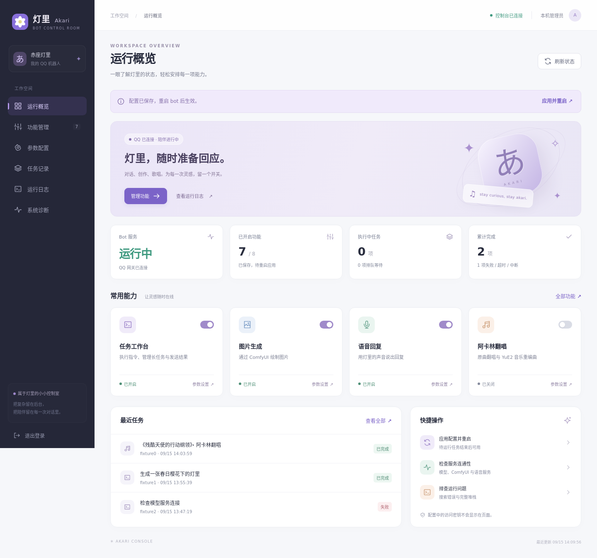

<div align="center">

# Akari Bot · 阿卡林

**一个能聊天、创作、唱歌和处理工作任务的 QQ Bot。**

Python 核心 · 多模态交互 · 持久任务队列 · 阿卡林音乐 · Web 控制台

[快速开始](#快速开始) · [控制台](docs/admin.md) · [任务指令](docs/tasks.md) · [唱歌功能](docs/singing.md) · [部署](docs/deployment.md) · [开发测试](docs/development.md)

</div>

## 角色对话与任务助手

灯里同时保持角色身份和 QQ 任务助手职责。授权用户可直接描述需求，角色对话模型理解当前消息与必要上文，再通过 `akari_task` 工具登记后台任务；不必先开启工作模式。询问能力、讨论方案或明确要求先不执行时不应派发。`/任务` 和音乐提交命令也先经过角色理解；`/进度`、`/取消`、`/文件` 等控制指令仍直接执行，不等待模型。`/聊` 明确只聊天。

角色负责理解、沟通、派发与进度解释，Pi 负责实际执行。提示词列出当前功能开关、职责与权限，后台再次检查授权、队列限制与会话范围。任务保留完整用户原文、换行、文件参数及附件；同一消息的重复工具调用只登记一个任务。

完成后由同一角色模型根据真实状态、关键结果和附件信息生成简短回复；不会自动发送整段报告、原始堆栈或重复错误。完整正文通过 `/全文` 或 `/结果` 获取，日志和附件仍保留。润色请求有 20 秒网络超时，失败使用明确的短回执。角色结果不能证明 QQ 已送达；发送状态仍以真实接口记录为准。

角色结果模式停止自动的中途进度/产物推送，统一在完成后交付；主动查询不受影响。相同音频的 MP3/WAV 默认只自动发送 MP3，WAV 仍可用 `/文件` 获取。结果摘要缓存、发件箱去重，重启不会重新润色和重复发送已登记通知。

控制台“任务”参数可切换 `role_task_dispatch`、`role_task_results`。关闭后恢复原有直接派发/详细结果模式。角色理解仍可能有误，重要的版本、文件范围和执行限制请明确说明；无需角色判断的控制操作继续使用对应指令。


## 能做什么

| 能力 | 实现与说明 |
| --- | --- |
| 角色聊天 | 赤座灯里人设；对接兼容 Chat Completions 的模型服务；历史上下文、群聊 @ / 关键词触发 |
| 多模态互动 | 图片理解、联网搜索、表情回复；视觉理解需要所接模型支持图片输入 |
| 图片与视频 | 对接本机 ComfyUI 工作流，支持等待、超时、冷却与媒体交付 |
| 语音回复 | 调用独立 TTS 服务，仓库提供 IndexTTS 适配服务源码 |
| 原创音乐 | Pi 自动填写歌词、风格和种子 → YuE2 原创 → 默认参考音色转换 |
| 原曲翻唱 | Demucs 分离人声/伴奏 → Seed-VC 保留音高转换音色 → FFmpeg 混音，支持短片段试听 |
| 音乐重编曲 | SheetSage2 转谱（或用户提供 ABC）→ YuE2 生成 → Seed-VC 音色转换 |
| 任务工作台 | Pi CLI 工具执行；任务排队、会话隔离、进度、取消、完整结果、附件和补发 |
| 控制台 | 功能开关、参数、QQ/进程状态、任务、错误日志、服务操作和 GPU 诊断 |

聊天与任务控制分别处理，耗时的模型回复不会阻塞 `/进度`、`/取消` 等指令。任务和发件箱存入 SQLite，重启后可以追踪状态与未送达内容。

### 控制台预览

以下截图使用隔离测试数据，未包含真实聊天记录。



[查看手机界面](docs/assets/console-mobile.png)

## 仓库内容与边界

这里包含 Bot 核心、前端、适配器、测试及部署辅助脚本。**模型权重、第三方模型仓库、歌曲、参考声音、表情素材、运行配置和用户记录需自行准备**。克隆源码不等于已安装所有生成服务。

示例配置只启用基础聊天与联网搜索，其余可选功能默认关闭；任务授权名单为空。请完成依赖配置后逐项开启。现有生产配置不会随仓库发布。

## 环境要求

- **Linux、Python 3.11+**：进程组、文件锁与任务恢复依赖 Linux/POSIX；当前验证环境为 Python 3.12。
- **QQ 机器人应用**：配置 App ID、App Secret，并在平台配置与使用场景对应的事件、消息与媒体权限。
- **模型服务**：聊天地址形如 `http://127.0.0.1:8000`；Bot 会追加 `/v1/chat/completions`。
- **按功能安装**：Pi CLI + Node.js（任务执行）、FFmpeg/ffprobe（媒体）、Pillow（图片处理）、ComfyUI、TTS 和音乐独立环境。
- **GPU**：只用于依赖 GPU 的生成服务，核心 Bot 和控制台本身无需 GPU。

核心和控制台使用 Python 标准库；图片/视频预处理可选依赖见 `requirements-optional.txt`，音乐环境依赖见 `music/`。

## 快速开始

### 1. 获取代码并初始化配置

```bash
git clone https://github.com/222222222l/Akari-Bot.git
cd Akari-Bot
python3 scripts/init_config.py
```

初始化脚本从示例生成 `config.json` 和 `music/config.json`，将本地文件路径转换为当前仓库绝对路径；**重复执行不会覆盖已有配置**。

### 2. 填写 QQ 与模型配置

编辑 `config.json`：

```json
{
  "app_id": "你的 QQ App ID",
  "app_secret": "你的 QQ App Secret",
  "llm_base": "http://127.0.0.1:8000",
  "model": "模型服务实际加载的模型名",
  "llm_key_file": "/你的仓库路径/secrets/llm.key",
  "group_reply_mode": "at_only"
}
```

上面是关键字段节选，请在初始化生成的完整配置中修改，不要直接覆盖成这个片段。

将模型 API Key 写入 `secrets/llm.key`；若本机模型服务不需要鉴权，保留一个空的 key 文件即可：

```bash
touch secrets/llm.key
chmod 600 secrets/llm.key
# 使用编辑器填写模型 API Key；不要提交此文件。
```

`llm_base` 不要带 `/v1`；Pi 的 provider `baseUrl` 通常需要 `/v1`，两者配置方式不同。`intents` 示例值来自本项目现有接入配置，须结合自己的 QQ 应用事件权限核对。

### 3. 启动 Bot 与控制台

```bash
export AKARI_BASE="$(pwd)"
python3 akari_bot.py
```

在另一终端、同一仓库目录启动控制台：

```bash
python3 akari_admin.py --port 18763
cat state/admin/access.token
```

在服务器本机打开 **http://127.0.0.1:18763**，用上述访问口令登录。口令不会打印在启动日志中。端口已占用时可使用 `--port` 另选端口。

手动启动时可读写配置、查看任务和日志；控制台的启动/停止/重启与进程状态查询针对 `akari-bot.service`。要使用这些操作，请先完成 [systemd 部署](docs/deployment.md)。

### 4. 按需启用能力

| 功能 | 启用前准备 |
| --- | --- |
| 图片理解 | 视觉模型；打开 `vision_enabled` |
| 表情 | 将自己的图片放入 `stickers/`；打开 `sticker_enabled` |
| 图片 / 视频 | 安装 ComfyUI、准备兼容的工作流并设置输入/输出路径，详见 [部署文档](docs/deployment.md) |
| 语音 | 配置可用 `voice_url`，确认 `POST /tts` 返回 WAV；打开 `voice_enabled` |
| 任务 | 安装并配置 Pi，填写 `agent_provider`、`agent_model` 和 `agent_allowed_openids`；打开 `agent_enabled` |
| 翻唱 | 准备参考声音，安装音乐环境；同时启用任务和 `music_enabled`，详见 [唱歌文档](docs/singing.md) |

Bot 配置保存后需要重启；音乐内部参数由下一次音乐任务读取。控制台会显示哪些修改尚未保存、哪些配置尚待重启。

## 在 QQ 中使用

```text
/帮助
/任务 检查项目并生成测试报告
/工作 开
/进度
/取消
/结果
/文件
/补发
/工作 关
```

`/工作 开` 后的消息作为工作任务，`/聊 内容` 可临时闲聊。授权身份按用户和会话隔离，群成员不共享执行上下文或任务查询权限。

音乐任务可直接描述需求，无需先准备音频或参数：

```text
/音乐 写一首关于雨后放学的日语动漫歌
/唱歌 帮我翻唱《残酷天使的行动纲领》
/翻唱 残酷天使的行动纲领 /片段 30
/唱歌 /重编曲
（从下一行填写歌词，也可附带 UTF-8 .txt 和 .abc 文件）
```

支持本地曲库、附件、公开歌曲链接；缺少本地源时可自动搜索下载。原生 Pi 工具选择来源、填写参数并执行，明确音乐请求可自动路由。默认参考 `music/songs/三上枝織 - ハイっ!アッカリーン.mp3`，自动提取有效人声片段并缓存；参考文件需自行提供。原曲翻唱保留伴奏和节奏；YuE2 重编曲可能改变编配、速度和时长。

完整命令和交付规则见 [任务工作台](docs/tasks.md)、[唱歌功能](docs/singing.md)。

## 目录结构

```text
akari_bot.py              QQ 网关、聊天和分发入口
akari_commands.py        指令解析与授权
akari_tasks.py           SQLite 任务、会话、发件箱
akari_worker.py          执行队列、取消、超时、产物收集
akari_agent.py           Pi JSON 流桥接
akari_context.mjs        上下文归档、图片与文本预算
akari_delivery.py        QQ 发送、补发和错误处理
akari_upload.py          分片上传与进度
akari_image.py           ComfyUI 图片适配
akari_video.py           视频生成与媒体适配
akari_voice.py           TTS 客户端
akari_music.py            唱歌命令
akari_sing.py             原创 / 原曲翻唱 / YuE2 重编曲管线
akari_music_tools.mjs     原生 Pi 音乐工具
akari_music_tool.py       参数校验、任务反馈与调用收据
akari_music_source.py     搜索、公开音源下载及来源记录
akari_music_reference.py  默认参考人声提取与缓存
akari_admin.py           控制台 HTTP API、登录与配置保存
akari_admin_schema.py    可编辑配置白名单与校验
akari_runtime.py         Bot 运行状态记录
admin/                   无构建步骤的中文响应式前端
music/                   音乐安装脚本、示例配置与本地验证入口
voice/                   可选 IndexTTS 服务适配器
scripts/                 配置初始化、服务文件生成
config.example.json      无凭据的配置模板
persona.txt              角色提示词
tests/                  单元、集成与浏览器测试
```

## 开发与验证

```bash
python3 -m unittest discover -s tests -v
node tests/test_context.mjs
```

发布前在独立检出中验证；测试不发送 QQ 消息。部分集成测试需要 Pi、FFmpeg 和本机 HTTP 监听权限，缺少 Pi 的测试会跳过。模型推理测试、真实 Bot 浏览器验收须显式运行，不属于默认测试。

测试方法、浏览器依赖及扩展方式见 [开发文档](docs/development.md)。

## 数据与维护

- `config.json`、`secrets/`、`state/`、生成音频和模型缓存都被 `.gitignore` 排除。
- 任务运行目录保留原始指令、附件、日志和产物；备份与迁移时应一起考虑 `state/`。
- 运行任务时禁止从控制台重启/停止；进程意外退出时，运行任务标记为中断，保留产物供核对，不自动重放外部操作。
- QQ 的可上传格式、大小、主动消息额度以对应应用的实际响应为准，项目配置阈值不是平台保证。
- 控制台默认只监听本机，远程使用方式见 [控制台文档](docs/admin.md)。

## 上游与许可

音乐能力使用 [YuE / YuE2](https://github.com/multimodal-art-projection/YuE)、[Seed-VC](https://github.com/Plachtaa/seed-vc) 与 [SheetSage2](https://huggingface.co/m-a-p/SheetSage2)，安装脚本固定了所验证的源码/模型版本。人声分离使用 Demucs，媒体处理使用 FFmpeg。

第三方实现和权重遵守各自许可，未打包进此仓库。音频、参考声音与角色素材由部署者自行准备并确认使用权限。本仓库当前未指定独立开源许可证。
